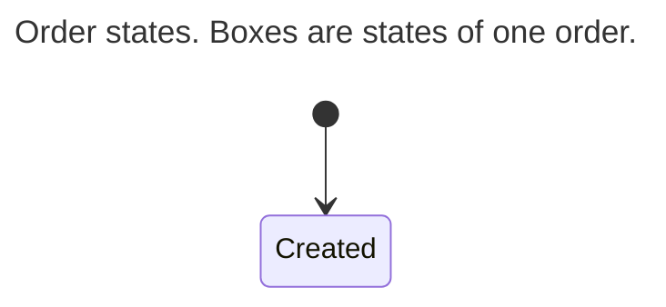
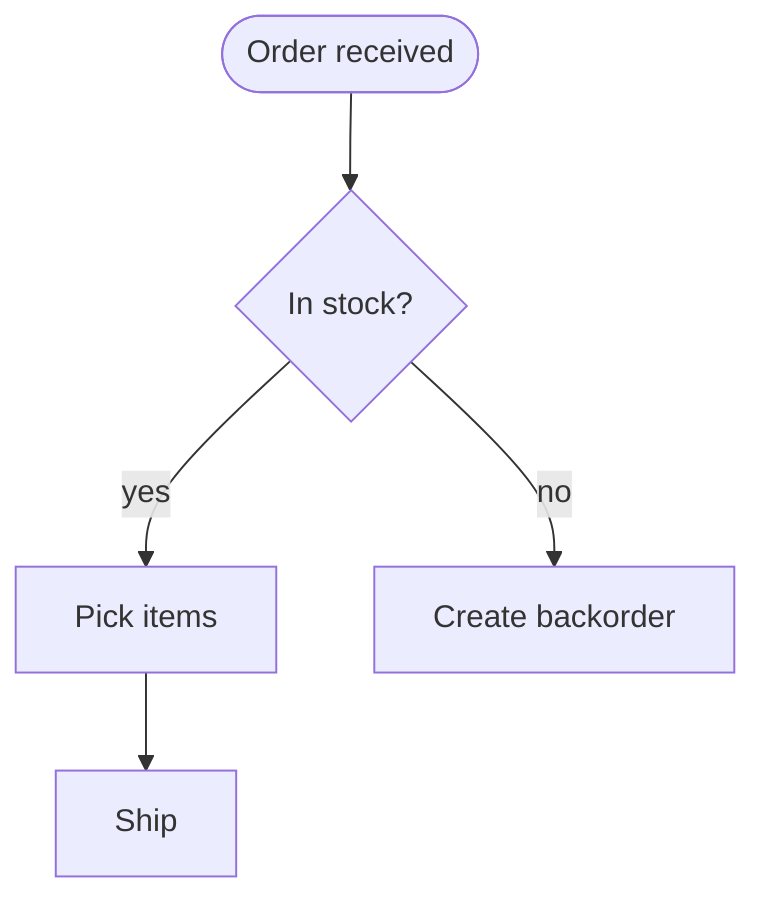
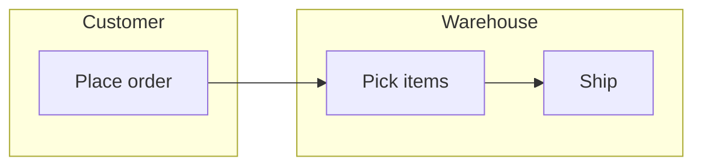
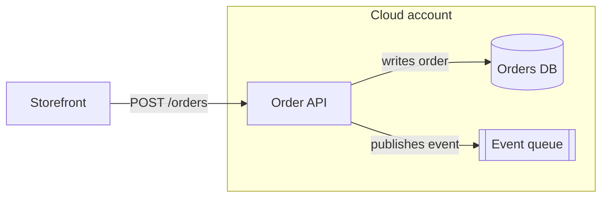
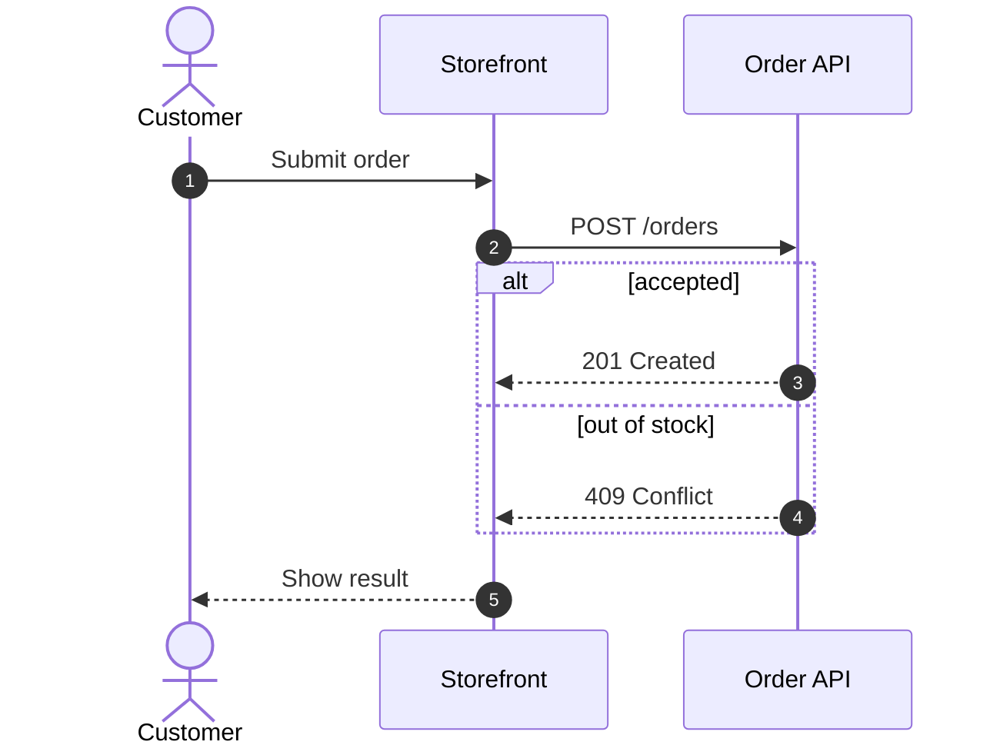
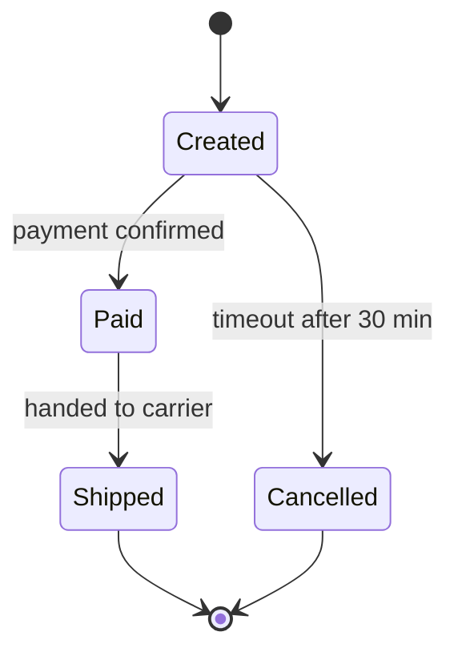
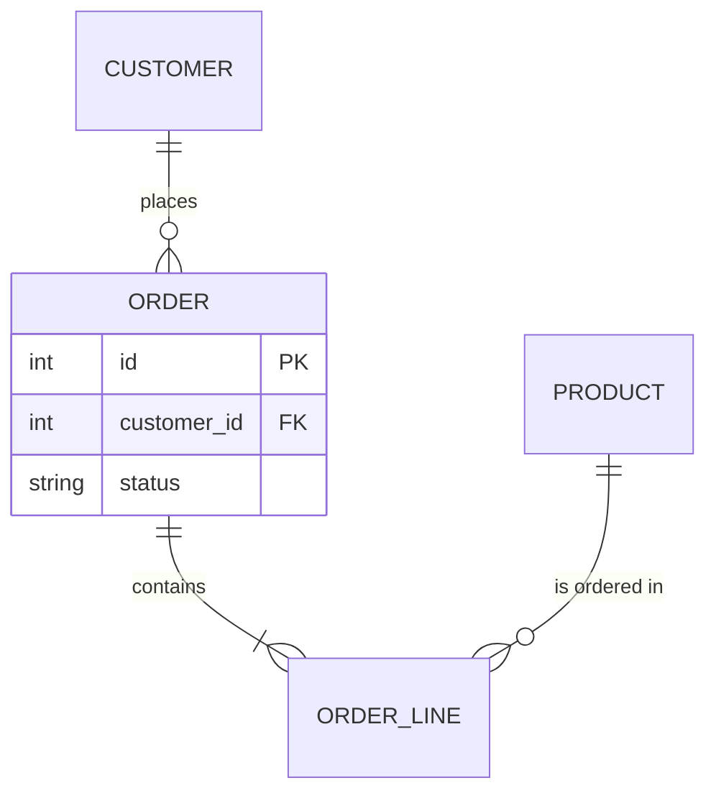

# Mermaid: syntax per type and what breaks rendering

## Mistakes that break rendering

- **Quote labels that contain punctuation.** Parentheses, brackets, colons, slashes and quotes inside an unquoted label end it early: write `A["Parse (strict)"]`, not `A[Parse (strict)]`. Inside quotes, write a double quote as `#quot;`.
- **`end` is a keyword.** A flowchart node whose id or bare label is `end` breaks the diagram. Use `End`, `done`, or quote the label.
- **Ids have no spaces.** Give a short id and put the wording in the label: `review["Awaiting review"]`, and in state diagrams `state "Awaiting review" as review`.
- **Line breaks in labels** are ` `, not `\n`.
- **One statement per line.** Do not put a comment (`%%`) after a statement on the same line.
- **Do not hard-code colors without their pair.** A `classDef` or `style` that sets only `fill` leaves the text color to the theme, which makes it unreadable in the other theme. Set `fill`, `stroke` and `color` together, or set none and let the viewer's theme decide. GitHub renders Mermaid in the reader's light or dark theme.
- **Keep to widely supported syntax** when the diagram will be read on GitHub or another host: the host's Mermaid version may be older than the current release, and newer diagram types and shapes fail there.

## Title and accessibility

The front-matter `title` is where the box declaration goes. `accTitle` and `accDescr` are read by screen readers.

## Flowchart

- `TD` for a procedure, `LR` for a pipeline.
- Shapes: `(["..."])` start or end, `["..."]` step, `{"..."}` decision, `[("...")]` data store.
- Edge label: `A -- label --> B` or `A -->|label| B`.

Swimlane, one subgraph per actor:

Component diagram, where boxes are components and subgraphs are boundaries:

## Sequence

- `->>` is a call, `-->>` a reply, `-)` an asynchronous message that the sender does not wait for.
- `+` and `-` after the arrow (`web->>+api`, `api-->>-web`) open and close the activation bar. They are counted in text order, so one `+` takes exactly one `-`: do not close the same activation in both branches of an `alt`.
- Blocks: `alt` / `else`, `opt`, `loop`, `par` / `and`, each closed with `end`.
- `Note over a,b: text` for a condition that spans participants.

## State

- `[*]` is both the start and the end marker.
- Composite states: `state Fulfilment { ... }`. Use them for sub-states of one state, not for grouping unrelated states.

## ER

- Cardinality is written once per side, mirrored. Left side: `||` exactly one, `|o` zero or one, `}|` one or more, `}o` zero or more. Right side: `||`, `o|`, `|{`, `o{`. Read each side as how many of the entity next to it.
- Quote a relationship label that has spaces.

## C4

Mermaid's C4 diagrams (`C4Context`, `C4Container`, `C4Component`) are experimental and render unevenly across hosts. When the diagram must render on GitHub, draw the C4 level as a flowchart with the element type and technology in each label, and say in the title which level it is. Use the C4 syntax, or PlantUML with C4-PlantUML, when the user asks for it.
